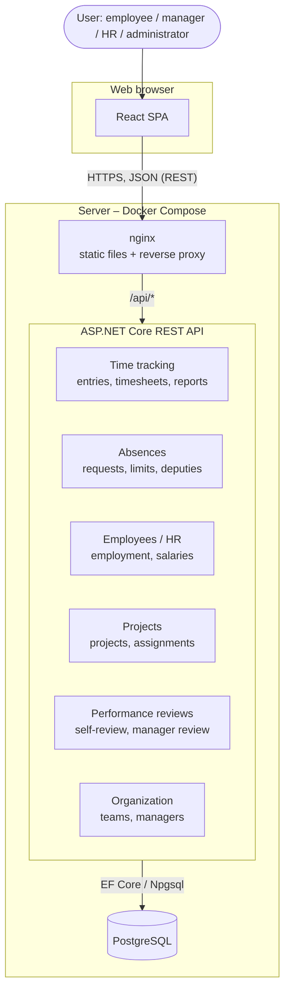
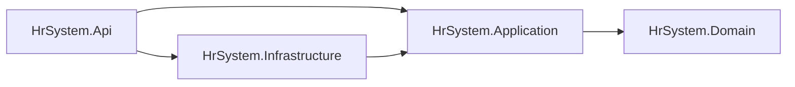
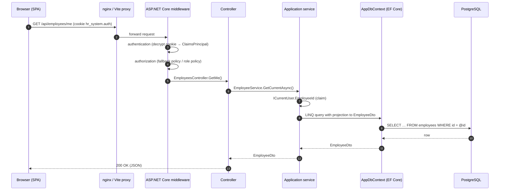
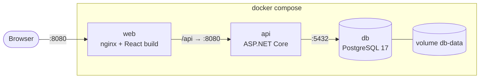

# Architecture

This document describes the architecture set up in the first milestone (application skeleton).
It is the technical basis for section 3.2 of the project documentation.

## 1. Overview

The system is a **modular monolith**: a single ASP.NET Core application exposing a REST API,
used by a React single-page application and backed by one PostgreSQL database. For the expected
scale (up to a few thousand employees, ~660k time entries per year for 1000 employees) a single
deployable unit and a single relational database are sufficient, and they are much simpler to
develop, test and deploy than distributed services. Modules are kept separate inside the code base
so that the system can grow without restructuring.



The browser talks to a **single origin**: nginx (in Docker) or the Vite dev server (in development)
serves the SPA and forwards `/api/*` to the backend. This lets the API use a strict
`SameSite=Strict` session cookie and avoids CORS configuration entirely.

## 2. Backend

### 2.1 Layers

The backend follows the Clean Architecture dependency rule: dependencies point inwards, and the
business logic does not depend on frameworks, the database or HTTP.



| Project            | Responsibility | Key elements |
|--------------------|----------------|--------------|
| **Domain**         | Business entities and rules that must always hold. No external dependencies. | `Entity` (GUID v7 ids), `IAuditableEntity`, `DomainException`, `Employee` |
| **Application**    | Use cases of the system, expressed as application services per module. Defines the abstractions it needs from the outside world. | `IAppDbContext`, `ICurrentUser`, `EmployeeService`, DTOs, `Roles`, `NotFoundException`, `ForbiddenAccessException` |
| **Infrastructure** | Implementation of the abstractions: persistence, identity, seeding. | `AppDbContext` (EF Core + Npgsql), entity configurations, migrations, `ApplicationUser`, `UserAdministrationService`, `DatabaseInitializer` |
| **Api**            | HTTP entry point: routing, (de)serialization, authentication, authorization, mapping exceptions to HTTP responses. | Controllers, `CurrentUser`, `Policies`, `GlobalExceptionHandler`, `Program.cs` |

Application services use EF Core through `IAppDbContext` (which exposes `DbSet`s) instead of a
separate repository layer. `DbSet` already implements the repository/unit-of-work patterns, and this
keeps LINQ projections to DTOs (executed as SQL) available in the use cases.

### 2.2 Functional modules

Each module from the logical diagram maps to a namespace/folder with the same name in every layer
(e.g. `HrSystem.Domain.TimeTracking`, `HrSystem.Application.TimeTracking`) and to a route in the
frontend.

| Module (documentation)  | Backend namespace | Frontend route(s)              | Milestone  |
|-------------------------|-------------------|--------------------------------|------------|
| Czas pracy              | `TimeTracking`    | `/time-tracking`, `/approvals` | 19.12.2026 |
| Nieobecności            | `Absences`        | `/absences`, `/absence-calendar`, `/approvals` | 19.12.2026 |
| Projekty                | `Projects`        | `/projects`                    | 19.12.2026 |
| Organizacja             | `Organization`    | `/organization`                | 19.12.2026 |
| Kadry (pracownicy, zatrudnienie, wynagrodzenia) | `Employees` | `/hr`             | 19.12.2026 / 16.01.2027 |
| Oceny pracownicze       | `Reviews`         | `/reviews`                     | 16.01.2027 |
| Raporty                 | `Reports`         | `/reports`                     | 16.01.2027 |
| Uwierzytelnianie i uprawnienia | `Users`, Identity | `/login`, `/admin/users`  | 21.11.2026 |

The `Employee` entity is shared by all modules: every user account is linked to exactly one employee
profile, and time entries, absence requests, reviews etc. reference the employee.

### 2.3 Request processing



Errors thrown in services are converted to [RFC 9457 problem details](https://www.rfc-editor.org/rfc/rfc9457)
by `GlobalExceptionHandler`:

| Exception                   | HTTP status                 |
|-----------------------------|-----------------------------|
| model validation (`[ApiController]`) | 400 Bad Request (with `errors`) |
| no/expired session          | 401 Unauthorized            |
| missing role / `ForbiddenAccessException` | 403 Forbidden |
| `NotFoundException`         | 404 Not Found               |
| `DomainException`           | 422 Unprocessable Entity    |
| any other exception         | 500 (details are logged, not returned) |

### 2.4 Data access

- **EF Core code-first** with migrations kept in `Infrastructure/Persistence/Migrations`; pending
  migrations are applied at startup by `DatabaseInitializer`, which then seeds roles, the
  administrator account and (optionally) demo accounts.
- Tables and columns use **snake_case** names (`EFCore.NamingConventions`), the PostgreSQL convention.
  ASP.NET Core Identity tables are renamed to `users`, `roles`, `user_roles`, ….
- Primary keys are **GUID v7** generated in the application: they are time-ordered (index friendly)
  and known before the row is inserted.
- `created_at` / `updated_at` of entities implementing `IAuditableEntity` are set in
  `AppDbContext.SaveChanges` using an injectable `TimeProvider` (testable clock).
- Timestamps are stored as `timestamp with time zone` (UTC).

## 3. Security

| Requirement (2.3.3)                 | Implementation |
|-------------------------------------|----------------|
| Authentication required             | Fallback authorization policy requires an authenticated user on every endpoint; only `login`, `logout` and `/health` are `[AllowAnonymous]`. |
| Passwords stored only as hashes     | ASP.NET Core Identity `PasswordHasher` (PBKDF2 with HMAC-SHA512, random salt). Minimum length 8 with character class rules. |
| Brute-force protection              | Account lockout for 15 minutes after 5 failed sign-in attempts. |
| Role-based access control           | Roles `Employee`, `Manager`, `Hr`, `Admin` (a user can have several). Endpoint-level checks via policies (`[Authorize(Policy = Policies.Hr)]`); data-level checks (e.g. "a manager sees only their subordinates") in application services via `ICurrentUser`. |
| Session handling                    | Encrypted `HttpOnly`, `SameSite=Strict` cookie (8 h, sliding). Not readable by JavaScript (XSS cannot steal it) and not sent on cross-site requests (CSRF). Marked `Secure` when the request came over HTTPS. |
| HTTPS                               | TLS is terminated by the reverse proxy (nginx / load balancer); the API honours `X-Forwarded-Proto` and sends HSTS outside Development. |
| Validation on client and server     | HTML5/Mantine form validation in the SPA, data annotations + domain invariants on the server. |
| No information leakage              | Unexpected errors return a generic 500 problem response; details are only logged. |
| Audit log                           | Planned together with HR data and permission management (milestones 2–3). |
| Backups                             | PostgreSQL data lives in the `db-data` volume; backup and restore with `pg_dump` / `pg_restore` (see README). |

The frontend hides menu items and pages the user has no role for (`RequireRole`, filtered
navigation), but this is only a usability feature: the backend enforces every rule independently.

## 4. Frontend

```
src/
  api/         fetch wrapper (ApiError + problem details), TanStack Query client
  auth/        AuthProvider/useAuth, route guards (RequireAuth, RequireRole), roles
  layout/      application shell and navigation (menu definition)
  pages/       generic pages: login, dashboard, 403, 404, error boundary, placeholders
  features/    one folder per module: API calls, query keys, pages and components
  router.tsx   route table
```

- **Server state** is managed by TanStack Query (caching, loading/error states, invalidation).
  The signed-in user is the `['auth', 'me']` query; a 401 from any request clears it, which makes
  `RequireAuth` redirect to the login page.
- **Navigation** (`layout/navigation.ts`) is the single source of truth for modules: label, path,
  icon, required roles and milestone. It drives the menu, the dashboard tiles and the routes, so a
  module's visibility rules are defined in one place.
- **UI**: Mantine component library (forms, tables, dates, notifications), Polish user interface.

## 5. Deployment



Configuration follows the standard ASP.NET Core model (`appsettings.json` →
`appsettings.{Environment}.json` → environment variables), so the same image runs in every
environment. Secrets (database password, administrator password) are provided via environment
variables (`.env`).

## 6. Adding a new module (checklist)

1. **Domain** – entities and business rules in `HrSystem.Domain/<Module>`.
2. **Infrastructure** – `DbSet` in `AppDbContext` (+ `IAppDbContext`), an
   `IEntityTypeConfiguration` in `Persistence/Configurations`, then a migration.
3. **Application** – DTOs and a `<Module>Service` registered in `AddApplication()`; enforce
   data-level permissions here using `ICurrentUser`.
4. **Api** – controller under `api/<module>` with the appropriate `[Authorize(Policy = …)]`.
5. **Tests** – integration tests in `HrSystem.Api.Tests`.
6. **Frontend** – `features/<module>/` (API + pages), register the page in `router.tsx`; the menu
   entry already exists in `layout/navigation.ts`.
